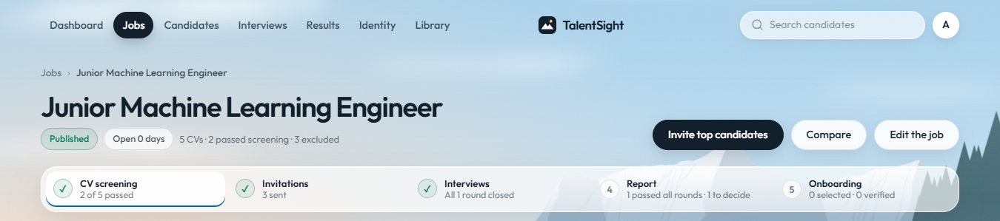
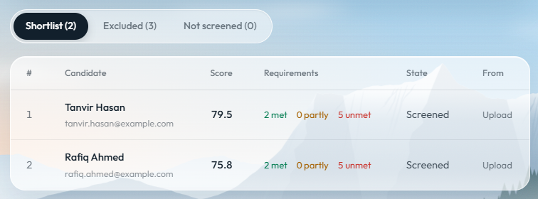
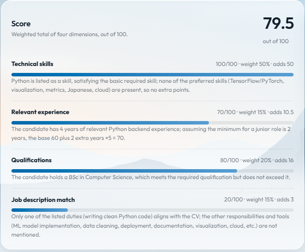
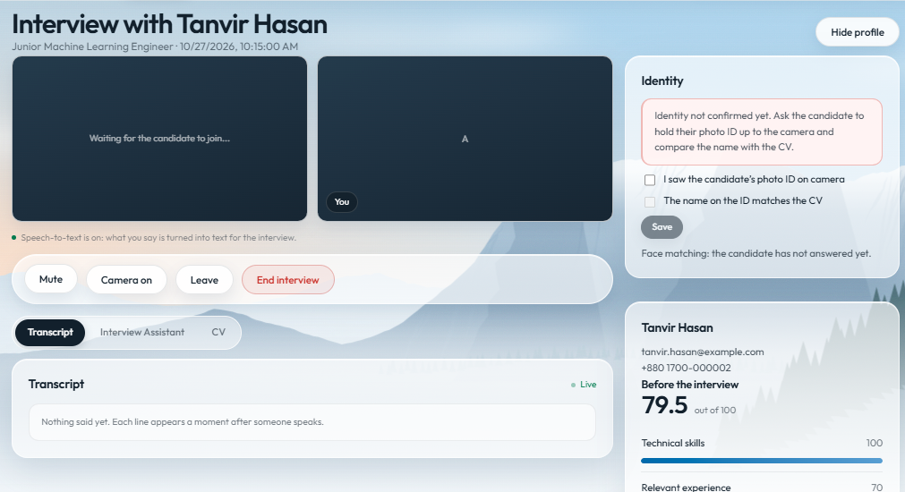
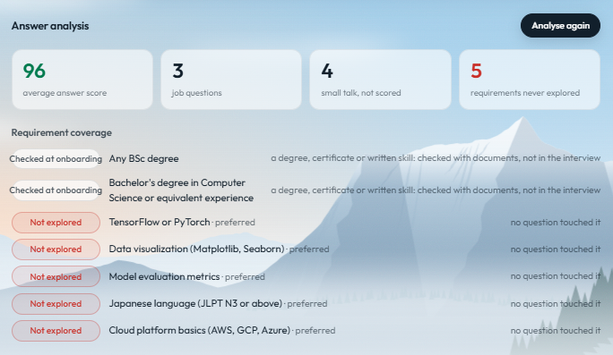
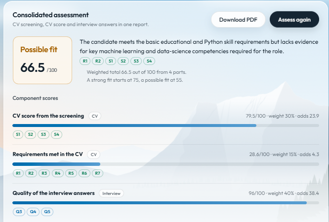
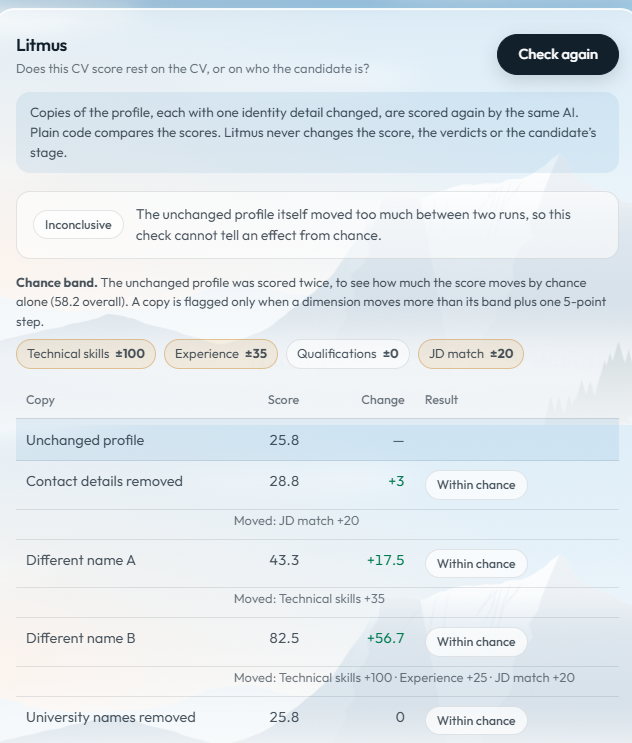
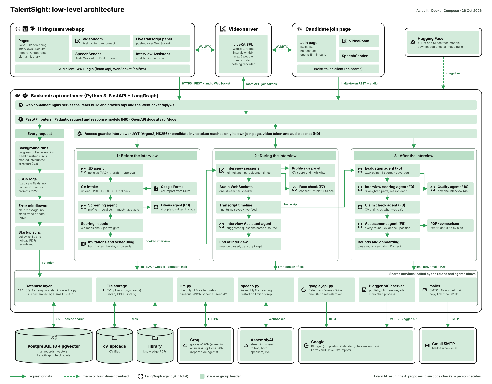
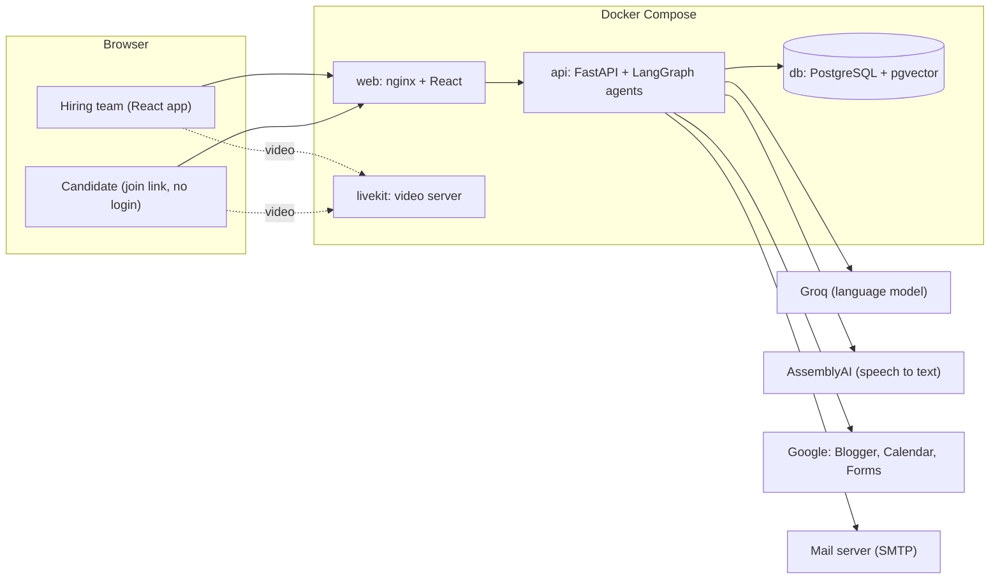
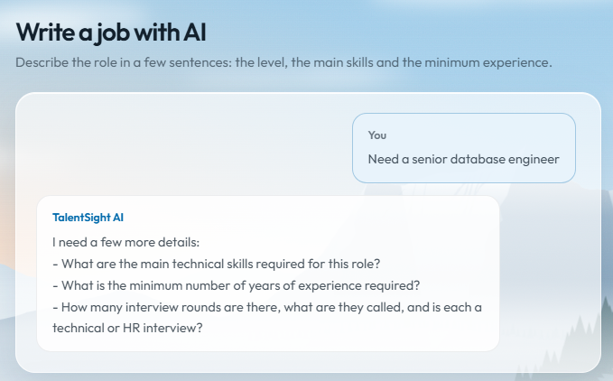

# 🎯 TalentSight

**TalentSight helps hiring teams find the right candidate faster by screening CVs, capturing interviews and turning both into one evidence-backed assessment.**

*Recruitment Intelligence Platform for Candidate Screening and Interview Assessment.*

[](./api)
[-1C3C3C?logo=langchain&logoColor=white)](./api/app/agents)
[](./web)
[](./docker-compose.yml)
[-FF6352)](./livekit)
[](./docker-compose.yml)
[](./api/tests)

<p align="center">
  <br>
  <em>The job page: five stages from CV screening to onboarding.</em>
</p>

> **The problem:** a hiring team reads dozens of CVs, runs interviews and then tries to remember why one candidate felt stronger than another. The reasons end up in someone's head, not in a record, and nothing shows whether the AI tools they use are fair.
>
> **The solution:** TalentSight follows each candidate from CV to onboarding. It reads every CV against every requirement, runs the video interview with a live transcript, analyses the answers and builds one assessment where **every conclusion points to its evidence**: a CV line, a transcript turn or a requirement. The AI proposes, plain code checks, and a person decides.

Product name, positioning and rationale: [docs/TalentSight — Product Name & Positioning.pdf](docs/TalentSight%20%E2%80%94%20Product%20Name%20%26%20Positioning.pdf)

---

## 👤 Author

**Ahsan Rizvi**, BJIT Academy, AI Trainee Developer Programme (Fresh Batch AI, July 2026). Final evaluation project.

---

## 🧭 What it does

| Stage | What happens |
|---|---|
| **Before the interview** | The hiring team writes a job with an AI assistant (checked against company hiring policies), uploads CVs or imports them from a Google Form, and each CV is read against every requirement, scored out of 100 and ranked. The top candidates are invited in bulk with AI-written e-mails, holiday-aware times and Google Calendar entries. |
| **During the interview** | A browser video call (the candidate joins from an e-mailed link, no account), a live transcript with the interviewer and candidate kept apart, a side panel with the candidate's profile and score, and an Interview Assistant chat that helps the interviewer. |
| **After the interview** | The answers are analysed against the job requirements, and one consolidated assessment is built from the CV and the interview, with the evidence behind every conclusion, a PDF export and a side-by-side comparison of candidates. |

---

## ✨ Features

### Core (all six)

| # | Feature |
|---|---|
| F1 | **CV screening and requirement-based ranking:** a verdict (met, partly met, unmet) with the CV line it rests on for each requirement; candidates missing a must-have are excluded with the reason shown |
| F2 | **AI-based candidate scoring:** four job-relevant dimensions with the job's own weights, a written reason for each, and the total worked out by plain arithmetic |
| F3 | **AI-powered video interview:** browser video room, session lifecycle, invite link for the candidate |
| F4 | **Real-time speech recognition:** live transcript, speaker-separated, timestamped, saved with the interview |
| F5 | **Question and answer analysis:** exchanges split from the transcript, scored on relevance, accuracy, completeness and articulation, and mapped to each requirement (explored, weak, not explored) |
| F6 | **Consolidated assessment:** one report with strengths, weaknesses, gaps and follow-up questions, each pointing to its evidence; PDF export and candidate comparison |

<p align="center">
  <br>
  <em>F1 and F2: the ranked shortlist</em>
</p>

<p align="center">
  <br>
  <em>F1 and F2: verdicts with their CV lines, and the score breakdown</em>
</p>

<p align="center">
  <br>
  <em>F3 and F4: the interview room with the live transcript</em>
</p>

<p align="center">
  <br>
  <em>F5: answer analysis and requirement coverage</em>
</p>

<p align="center">
  <br>
  <em>F6: the consolidated assessment with its evidence</em>
</p>

### Stretch (all four attempted)

| # | Feature |
|---|---|
| F7 | **Candidate identification and real-time profile overview:** the profile side panel in the interview room, and a consent-based identity check (photo ID checked by a person, face templates from the call, a head-turn check on onboarding day). Face-data rules are under [Privacy](#privacy) |
| F8 | **CV claim verification:** CV claims checked against the interview, shown as follow-up prompts for a person, never as accusations |
| F9 | **Comprehensive interview scoring:** one score in six weighted parts, each with a reason and the answer it rests on |
| F10 | **Interview quality assessment:** talk time, question types, follow-ups and requirement coverage, with recommendations that point to moments in the transcript |

**Also built:** interview rounds per job (the hiring process from the JD chat or the job form, each round Technical or HR, a pass mark or top N to close each round, next-round invitations and rejection e-mails), a report stage that selects new hires for onboarding, a live Interview Assistant for the interviewer, a dashboard, candidate and interview lists with search, company sign-up with a company code, and candidate deletion.

### 🧪 Innovation feature (F11): Litmus

**Litmus checks that a CV score rests on the CV, not on who the candidate is.**

<p align="center">
  <br>
  <em>The Litmus tab: the reference score, the repeat that measures chance, and the four changed copies.</em>
</p>

- **The problem:** the screening AI is told to ignore personal details, but nothing showed whether it does. A rule in a prompt is a promise, not a proof.
- **What it does:** for one candidate it scores the unchanged profile twice (to measure chance), then scores controlled copies of the profile, each with one identity detail changed: contact details removed, two different made-up names, and university names removed. Plain code compares the scores. A copy is flagged only when a score moves more than chance plus one 5-point step, or the must-have check changes.
- **Human in the loop:** a result that is not steady waits until an interviewer acknowledges it with a note. Litmus never changes a score, a verdict, the ranking or a stage.
- **Audit and cost:** every check is kept as its own record with the model, the prompt version, the AI calls, the tokens and the cost.
- **Where to find it:** the **Litmus** tab on a candidate's page, and the **Litmus** card at the bottom of a job's candidate page ("Check the top 5"). From the terminal: `docker compose exec api python -m scripts.litmus_run <job id>`.
- **Rationale:** [docs/innovation-rationale.md](docs/innovation-rationale.md)

---

## 🏗️ Architecture

<p align="center">
  <br>
  <em>Four containers in Docker Compose; the API holds the nine LangGraph agents, and the only code that talks to the language model is `app/llm.py`.</em>
</p>



### The nine LangGraph agents

| # | Agent | What it does |
|---|---|---|
| 1 | Job writing | Turns a short brief into a job profile checked against the hiring policies (RAG), and pauses for a person to approve it |
| 2 | CV screening | Reads one CV against one job: profile, requirement verdicts, must-have gate, four scores |
| 3 | Answer analysis | Splits the transcript into questions and answers, scores them and maps requirement coverage |
| 4 | Assessment | One report from the CV, its score and the answer analysis, with numbered evidence |
| 5 | Claim check | Compares what the CV claims with what the candidate said |
| 6 | Interview Assistant | A chat for the interviewer during the interview, with suggested questions that name their source |
| 7 | Interview quality | Reviews how the interview was run, not the candidate |
| 8 | Interview scoring | One interview score in six weighted parts |
| 9 | Litmus | Tests the screening scorer itself (the innovation feature) |

**The same rules in every agent:**

1. **The AI proposes, plain code checks, a person decides.** Totals and positions are arithmetic in code.
2. **Evidence or nothing.** Every conclusion must name a CV line, transcript turn or requirement that exists.
3. **One retry.** A failed check goes back to the AI once, with the problem stated.
4. **Clear failure.** If the model is down or slow, the agent ends in a `failed` state with a plain message (N6), and earlier results are kept.

**How the work runs:** long jobs (screening, answer analysis, assessment and the other reviews) run in the background and show their progress (N4). A restart marks a half-finished run as interrupted instead of leaving it stuck. **Access is separated (N9):** the hiring team logs in; a candidate only has their private interview link, which reaches nothing but their own join page.

Graphs of every agent and the design as built: [docs/architecture.md](docs/architecture.md) · diagrams in [docs/diagrams](docs/diagrams)

---

## 🛠️ Technology stack

| Part | Choice | Why |
|---|---|---|
| API | FastAPI, SQLAlchemy | Required stack; typed requests, automatic API docs at `/api/docs` |
| Agents | LangGraph | Required stack; explicit steps, loops and a pause for human approval |
| Language model | Groq, `openai/gpt-oss-120b` | Free tier, fast, structured answers; temperature 0 and a fixed seed for repeatable results |
| Database | PostgreSQL with pgvector | One database for records, vectors and LangGraph checkpoints, with no extra service |
| Embeddings | fastembed (`bge-small-en-v1.5`) | Runs locally on the CPU; no candidate text leaves the machine for matching |
| Video | LiveKit (self-hosted in Compose) | Open-source WebRTC; nothing is recorded |
| Speech to text | AssemblyAI streaming | Free tier without a card; Google Speech-to-Text asked for one |
| CV reading | pypdfium2, python-docx, Tesseract OCR | Text PDFs, Word files and scanned CVs |
| Face matching | OpenCV YuNet and SFace (Apache 2.0) | Local; only numbers are kept, no pictures |
| Web | React 19, TypeScript, Vite, nginx | Typed UI, one small static container |
| Job posts | MCP server for Blogger | Keeps the Google publishing call outside the agent |
| Containers | Docker Compose | Single-command start |

---

## 📦 Getting started

### Prerequisites

- Docker Desktop (or Docker Engine with Compose v2) and Git
- Internet access for the first build (images, packages and two small face-model files are downloaded)
- A free Groq API key and a free AssemblyAI API key
- Optional: a Google OAuth refresh token (blog posts, calendar entries, Form import) and an SMTP account (invitation e-mails)

### Set up and run

```powershell
git clone https://github.com/rizvibjit/talent-sight.git
cd talent-sight
copy .env.example .env
```

On macOS or Linux use `cp .env.example .env`. Open `.env` and set at least the values marked **required** in the [configuration reference](#configuration), then start everything with one command:

```powershell
docker compose up --build -d
```

Open <http://localhost:8080> and log in with `SEED_INTERVIEWER_EMAIL` and `SEED_INTERVIEWER_PASSWORD` from your `.env`. The API documentation is at <http://localhost:8080/api/docs>.

### Commands

| Task | Command |
|---|---|
| Build and start | `docker compose up --build -d` |
| See the logs | `docker compose logs -f api` |
| Stop (data is kept) | `docker compose down` |
| Reset (**deletes all data**) | `docker compose down -v` |
| Run the tests | `docker compose exec api pytest -q` |
| Make 20 fictional sample CVs | `docker compose exec api python -m scripts.make_sample_cvs /data/cv_uploads/samples` then `docker compose cp api:/data/cv_uploads/samples ./sample-cvs` |
| Delete a candidate and all their data | `docker compose exec api python -m scripts.delete_candidate <id> --yes` |

Data lives in named volumes (`pgdata`, `cv_uploads`) and survives `docker compose down` and a restart.

### Letting a candidate join from another device

`http://localhost:8080` means "this computer" on any other device. For a candidate elsewhere you need a public `https` address for the app (browsers only give the camera and microphone to a secure page), `PUBLIC_BASE_URL` set to it, and a video server address the browser can reach (`LIVEKIT_URL`). For a demo on one computer, use two browser windows.

---

<a id="configuration"></a>

## ⚙️ Configuration reference

All settings come from `.env`. `.env.example` lists them with placeholders; the real `.env` is never committed.

| Setting | Needed | Meaning |
|---|---|---|
| `POSTGRES_USER`, `POSTGRES_PASSWORD`, `POSTGRES_DB` | **required** | Database account and name |
| `JWT_SECRET`, `JWT_MINUTES` | **required** | Login token secret (use a long random string) and how long a login lasts |
| `SEED_INTERVIEWER_EMAIL`, `SEED_INTERVIEWER_PASSWORD` | **required** | The first hiring-team account, created at startup |
| `GROQ_API_KEY`, `LLM_MODEL` | **required** | Language model key and the default model (JD chat, Interview Assistant, e-mail wording) |
| `SCREENING_MODEL` | optional | Model for CV screening and Litmus (Litmus must use the screening model: it tests that scorer). Empty = `LLM_MODEL` |
| `EVALUATION_MODEL` | optional | Model for the interview answer analysis. Empty = `LLM_MODEL` |
| `ASSESSMENT_MODEL` | optional | Model for the report, CV claim check, interview score and quality review. Empty = `LLM_MODEL` |
| `ASSEMBLYAI_API_KEY`, `STT_MODEL` | **required** | Live transcription |
| `LIVEKIT_API_KEY`, `LIVEKIT_API_SECRET` | **required** | Video server keys (secret: 32+ random characters) |
| `LIVEKIT_URL`, `LIVEKIT_SERVER_URL` | **required** | Video address used by the browser, and by the API container |
| `PUBLIC_BASE_URL` | **required** | The address candidates open (default `http://localhost:8080`) |
| `COMPANY_NAME`, `SIGNUP_CODE`, `SIGNUP_EMAIL_DOMAINS` | optional | Company name in e-mails, and who may sign up |
| `SMTP_HOST`, `SMTP_PORT`, `SMTP_USER`, `SMTP_PASSWORD`, `MAIL_FROM` | optional | Invitation e-mails; leave `SMTP_HOST` empty to copy links by hand |
| `AI_MAIL` | optional | `true` lets the AI word invitation e-mails; `false` uses fixed wording |
| `GOOGLE_CLIENT_ID`, `GOOGLE_CLIENT_SECRET`, `GOOGLE_REFRESH_TOKEN` | optional | Google access for the features below |
| `BLOGGER_BLOG_ID`, `BLOGGER_BLOG_URL` | optional | Publishing job posts to a blog |
| `GOOGLE_CALENDAR_ID` | optional | Calendar for interview entries; empty = off |
| `GOOGLE_FORM_ID`, `GOOGLE_FORM_URL`, `GOOGLE_FORM_JOB_FIELD` | optional | Importing CVs from a Google Form |
| `INTERVIEW_MINUTES`, `INTERVIEW_GAP_MINUTES`, `INTERVIEW_WINDOWS`, `WORK_DAYS` | optional | Interview length, gap and working hours; holidays come from the calendar on the Library page |
| `CV_MAX_MB` | optional | Largest CV file (default 5) |
| `BIOMETRIC_RETENTION_DAYS` | optional | How long face templates are kept (default 60) |
| `LLM_PRICE_INPUT_PER_MILLION`, `LLM_PRICE_OUTPUT_PER_MILLION` | optional | Groq list prices in US dollars, used to show what a Litmus check cost (defaults 0.15 and 0.60) |
| `LIBRARY_DIR` | optional | Where the Library keeps its documents (default `/data/library`, the `library` Docker volume) |
| `LITMUS_SHORTLIST_SIZE` | optional | How many top candidates "Check the top" checks at once (default 5) |
| `CAREERS_EMAIL` | optional | Address shown on public job posts |

---

## 🚀 Using it

The job page has five stages, shown as a bar at the top: **CV screening**, **Invitations**, **Interviews**, **Report** and **Onboarding**.

1. Log in. Press **Write a job with AI**, describe the role and the hiring process (for example "an HR interview, then two technical rounds"), answer the AI's questions if it asks (it always asks about the interview rounds when the brief does not name them), and approve the draft. Or press **New job** and fill the form yourself, including the **interview rounds** and whether each one is a Technical or an HR round.
2. Publish the job. Publishing again later replaces the blog post with the job as it is now. Add CVs in the **CV screening** stage (PDF or DOCX) or import them from the Google Form.
3. Press **Screen the new CVs**. The **Shortlist** tab lists passing candidates by score; **Excluded** shows who missed a must-have and why.
4. Press **Invite top candidates**. They are booked into round 1 and e-mailed. The **Invitations** stage lists every e-mail of the job (invitations, rejections, onboarding) as sent, sending or failed.
5. The **Interviews** page lists every booked interview with its round. **Start interview** opens the room: video, live transcript, profile panel and the Interview Assistant.
6. In the job's **Interviews** stage, each round has its own tab, ranked by interview score. **Analyse finished interviews** runs the answer analysis, interview score and quality review of every finished interview. A row opens that interview on the **Results** page.
7. **Close round** lets you choose who passes: by a pass mark (60 by default), the top N (a tie at the cut asks you to pick), or by hand. Those who pass are booked into the next round and invited; the others get a rejection e-mail. Someone whose interview was cancelled or never took place gets a different e-mail: the interview could not go ahead, and the application will not move forward.
8. After the last round, the **Report** stage lists the finalists with their CV score, their score in each round and the consolidated assessment (built from every round, with the CV claim check). **Select for onboarding** sends the onboarding e-mail to those you choose and a rejection e-mail to the others.
9. On the first day, open **Identity check**, pick the new hire, check their photo ID and take their picture. The result shows in the job's **Onboarding** stage.

<p align="center">
  <br>
  <em>Step 1: the job writing agent asks about the interview rounds and waits for approval.</em>
</p>

---

<a id="privacy"></a>

## 🔒 Privacy

Details are in [docs/privacy.md](docs/privacy.md).

- **Data used:** only the fictional sample CVs and mock interviews. No real candidate data is in the repository (`cv_uploads/`, recordings and database dumps are git-ignored). Every screenshot in this README shows fictional sample data only.
- **Deletion (N19):** a candidate and everything about them can be deleted in the app, through `DELETE /api/candidates/{id}`, or with `scripts.delete_candidate`.
- **Minimisation (N16):** raw audio and video are never stored.
- **Face data (N17):** used only with the candidate's consent, shown in the flow. At most three face templates (numbers, no pictures) are kept per interview, for 60 days at most (`BIOMETRIC_RETENTION_DAYS`), and they are deleted with the candidate.
- **Logs (N22):** one JSON line per event with a fixed list of safe fields. Names, e-mail addresses, CV text, transcripts and prompts are never logged; invite tokens show as `***`.
- **Errors (N12):** an unexpected error shows a plain message, never a stack trace, path or prompt.

### Who receives candidate data (N18)

| Service | What it receives | Why |
|---|---|---|
| Groq (language model) | CV text, job text, transcript text and the prompts built from them | All AI analysis and writing |
| AssemblyAI | The live audio of the interview (both speakers) | Transcription. Check their data retention before using real interviews |
| Google (Blogger, Calendar, Forms) | The job post text (public); interview time and candidate name for the calendar entry; CVs submitted through the linked Form | Publishing, scheduling, import. Optional |
| Mail server (SMTP) | The candidate's address, interview time and link | Invitations. Optional |
| Hugging Face | Nothing about candidates. Two face-model files are downloaded when the image is built | Face matching |
| LiveKit | Runs in your own Compose stack. Video goes from the browsers to it and is not recorded | The video call |

### Fairness (N20)

- Scores come from four job-relevant dimensions weighted by the job's own settings. Age, gender, ethnicity, nationality, religion and marital status are not scoring inputs.
- The AI reads the whole CV, which can still contain such cues, and no model can be proved to ignore them. That is why every AI score shows its reasons, a person makes each decision, and Litmus tests the scorer.
- The only automatic rule is the must-have check, and the excluded candidate and the reason stay visible and can be reviewed.
- The interview chat and quality review block personal questions (age, family, religion and similar) with plain code, not only with the prompt.
- Face-matching accuracy varies between groups of people and with light and camera quality, so a result other than a match is sent to a person and never called fraud.

---

## ⏱️ Measured performance (N1)

20 sample CVs were parsed, screened, scored and ranked in **13 minutes (about 780 seconds, roughly 39 seconds per CV)** on 26 October 2026. Machine: Windows 11 Pro laptop, Intel Core i5-10210U, 16 GB RAM, running Docker Desktop. Model: Groq free tier, `openai/gpt-oss-120b`. The run was started once from a fresh job, and most of the time is spent waiting for the AI service, not on this laptop's processor. It includes any waits for the free tier's per-minute limit.

The test suite has 582 tests (`docker compose exec api pytest -q`). They run against their own test database and switch off the outside services.

---

## ⚠️ Known limitations

- AI output is imperfect. The system is built for transparency: evidence, checks and a human decision, not for benchmark accuracy.
- Interviews and transcription are English only. Streaming transcription does not support Bengali.
- The Groq and AssemblyAI free tiers have per-minute and per-day limits. A large CV batch is slower when they are reached, and the free AssemblyAI tier allows 5 new streams a minute. Every Groq model has its own limits, so `.env.example` spreads the work over two models (`openai/gpt-oss-120b` for screening and answer analysis, `openai/gpt-oss-20b` for the report-side agents). The screen says when a limit was reached, and a failed re-screen keeps the earlier result.
- One interview at a time was tested; the app is meant for local use through Docker.
- A Technical round is judged on the job's requirements and an HR round on HR topics (its focus text, or communication, motivation, teamwork, situational judgement, professionalism and expectations). Both use the same four answer dimensions, with a rubric written for each kind of round.
- Degrees, certificates and written skills cannot be shown in a spoken interview: the CV screening scores them and they are checked with documents at onboarding, so the interview never counts them as not explored.
- The head-turn check stops a held-up photo or a replayed video. It does not stop a live face swap. The photo-ID check by a person is the main safeguard.
- Litmus tests what the profile shows. A steady result means no effect was found for the changes it makes, not that the scorer is proven fair.
- Video for a candidate on another device needs the public setup described above.

---

## 📂 Repository layout

| Path | What is in it |
|---|---|
| **`api/`** | FastAPI app (`app/`), the nine LangGraph agents (`app/agents/`), tests, helper scripts and the knowledge PDFs |
| **`web/`** | React app and nginx config |
| **`livekit/`** | Video server config |
| **`docs/`** | The project documents listed below; `docs/assets/` holds the architecture picture and the screenshots used in this README (fictional sample data only) |

### Project documents

| Document | BID |
|---|---|
| [Product name and positioning](docs/TalentSight%20%E2%80%94%20Product%20Name%20%26%20Positioning.pdf) | P1.1 |
| [Requirement clarification](docs/requirement-clarification.xlsx) | P1.2 |
| [Work Breakdown Structure](docs/WBS%20-%20TalentSight_30219_Ahsan_Rizvi.xlsx) and [actual vs planned](docs/wbs-actual-vs-planned.md) | P1.3, P2.5 |
| [Innovation rationale](docs/innovation-rationale.md) | P2.4 |
| [Architecture and agent design as built](docs/architecture.md), [diagrams](docs/diagrams) | P2.6 |
| [Privacy and data handling](docs/privacy.md) | P2.7 |
