# Architecture and agent design (as built)

## Components

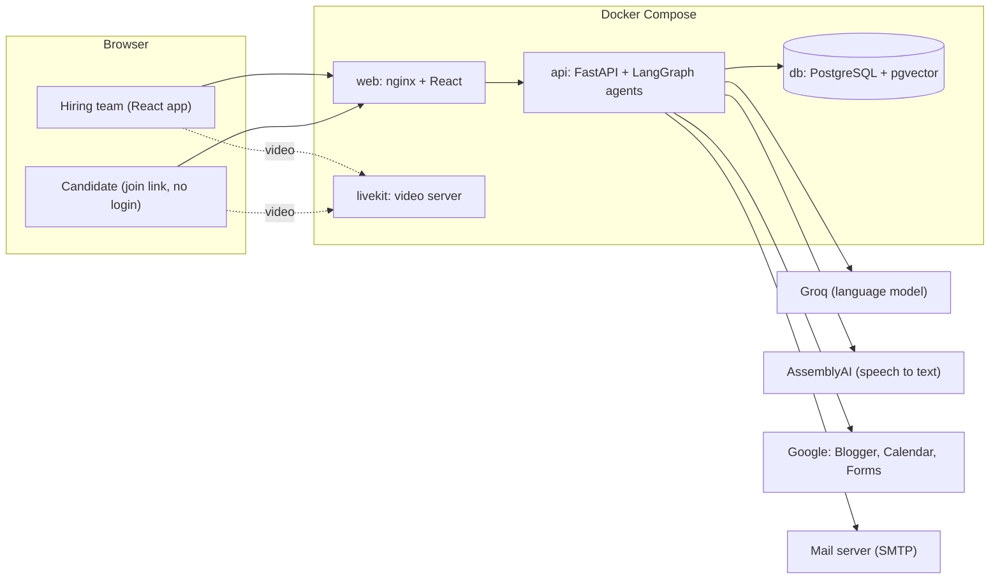

- **web** serves the React app and passes `/api` (and the WebSocket for live audio) to the API.
- **api** holds all business logic and the nine agents. The only code that talks to the language model is `app/llm.py`, so a failure becomes one clear error state (N6).
- **db** holds every record, the vectors used for matching and the LangGraph checkpoints.
- **livekit** carries the video call. Browsers connect to it directly with a token from the API. Nothing is recorded.
- During an interview each browser sends its microphone audio to the API, which streams it to AssemblyAI and saves the returned text as timestamped transcript lines for each speaker.

## How the work flows

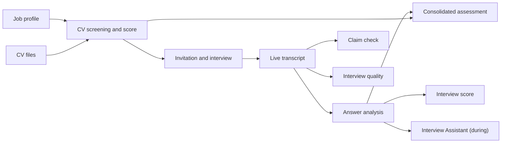

The CV screening result and the transcript are the two sources. The answer analysis adds requirement coverage, and everything after it reads those same facts through one shared context (`app/interview_context.py`), so the chat, quality review, score and claim check never disagree about what was said.

## Design rules used in every agent

1. **The AI proposes, plain code checks, a person decides.** Totals, positions and alignment are arithmetic in code. The AI never decides a candidate's position.
2. **Evidence or nothing.** Every conclusion names a line it rests on (a CV line, a transcript turn, a requirement). Code drops anything that points to a line that does not exist.
3. **One retry.** When a check fails, the AI is asked once more with the problem stated. After that the bad item is removed or shown as "not discussed", never as a flag without proof.
4. **Clear failure.** If the model is down or slow, the agent ends in a `failed` state with a plain message (N6). Nothing is half-saved.
5. **Same answer twice.** Temperature 0 and a fixed seed.
6. **Interviewer only.** Candidates can never reach any agent result (N9).

## How agents run

| Kind | Used by | How |
|---|---|---|
| Asks and pauses for a person | Job writing agent | LangGraph `interrupt()`, state kept in Postgres by the checkpointer, resumed when the person answers or approves |
| Background run with progress | CV screening, answer analysis, assessment, claim check, interview quality, interview score | A background run with a status the page polls every 2 seconds. At startup a run left half-finished is marked interrupted |
| Answered straight away | Interview Assistant | A few seconds, because the interviewer is waiting during the interview |

## The nine agents

### 1. Job writing agent (`jd_agent.py`)
Turns a short brief into a job profile checked against the company hiring policies (RAG over a policy PDF), and asks the person to approve before saving and posting it.

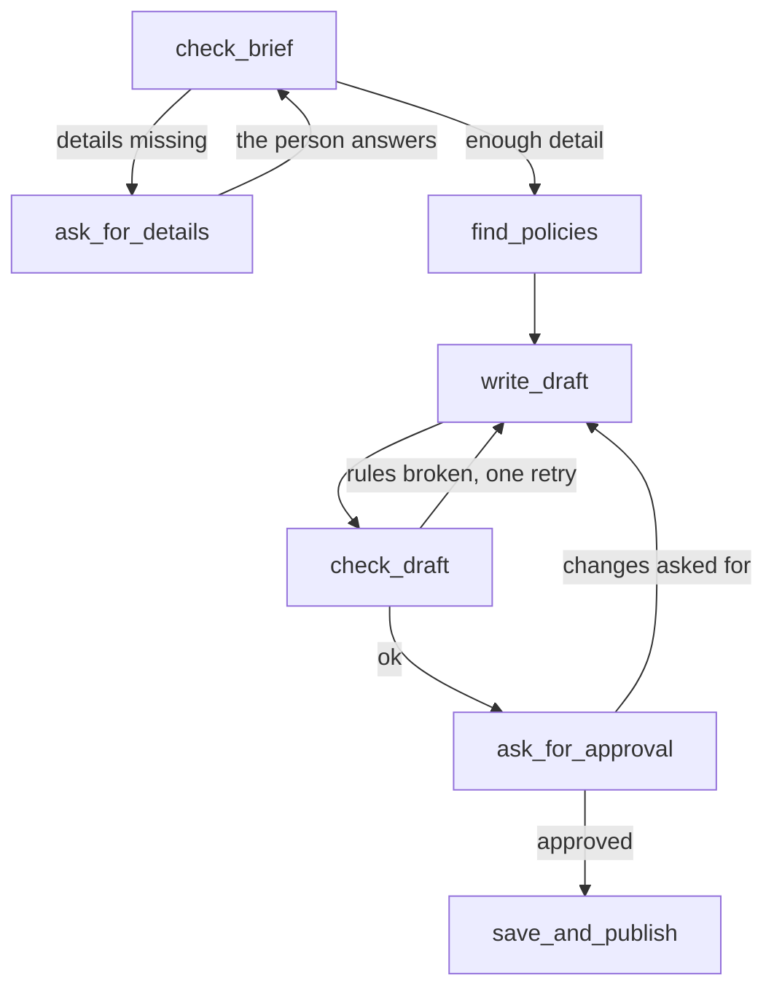

### 2. Screening agent (`screening_agent.py`)
Reads one CV against one job. The must-have gate and the score arithmetic are plain code.

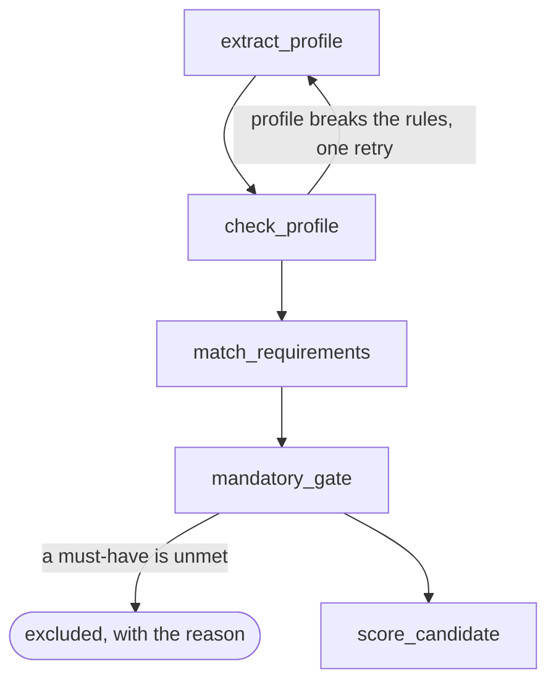

### 3. Evaluation agent (`evaluation_agent.py`)
Turns a transcript into scored question-and-answer pairs and requirement coverage.

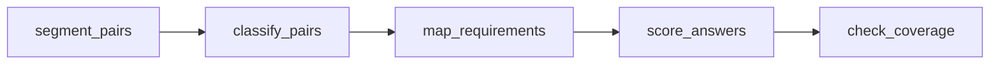

Small talk is kept but not scored. Each answer gets relevance, accuracy, completeness and articulation scores (0 to 100, retried once if out of range). A requirement is explored, weak (below 50) or not explored.

### 4. Assessment agent (`assessment_agent.py`)
One report from the CV screening, the CV score and the answer analysis.

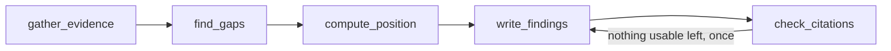

Evidence is numbered R (CV requirement), S (CV score), Q (interview answer) and C (interview coverage). The position is computed by code from weighted components, so the same inputs always give the same position.

### 5. Claim check agent (`claim_agent.py`, F8)
Compares what the CV claims with what the candidate said.

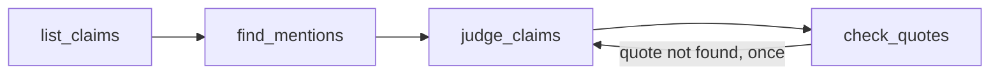

Four results: supported, contradicted, unsubstantiated, not discussed. A result other than "not discussed" must point to a turn that was shown and a quote the candidate really said. A contradiction needs a direct conflict. Soft-skill claims are skipped. Results are prompts for a person and never change a score.

### 6. Interview Assistant agent (`chat_agent.py`)
A chat assistant for the interviewer. It answers what was asked. Only when questions about the candidate are requested does it return suggestion cards.

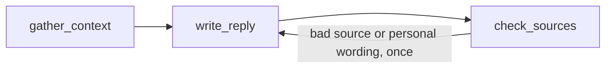

Each card names a CV line, a transcript turn or a requirement. Code checks the pointer and blocks personal topics in cards and replies (N20).

### 7. Interview quality agent (`quality_agent.py`, F10)
Reviews how the interview was run, not the candidate.

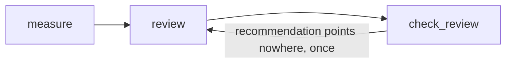

Talk time, questions, follow-ups, answer lengths, coverage and the averages of other interviews for the job are measured by code. The AI classifies each question (open, probing, closed, leading, unclear) and writes two to four recommendations that point to a transcript moment.

### 8. Interview scoring agent (`interview_score_agent.py`, F9)
One interview score in six weighted parts: technical competency 25, problem-solving 20, depth of experience 15, relevance of answers 15, communication 10 and alignment with requirements 15.

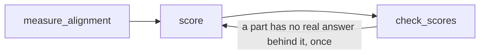

Alignment comes from requirement coverage by plain code. The other five parts come from the AI, each with a reason and a candidate turn. The weights are fixed, so totals can be compared between candidates.

### 9. Litmus agent (`litmus_agent.py`, F11, the innovation feature)
Tests the screening scorer itself: does a CV score rest on the CV, or on who the candidate is? The copies of the profile are made by plain code, and the comparison is plain code; the AI is only the thing being tested.

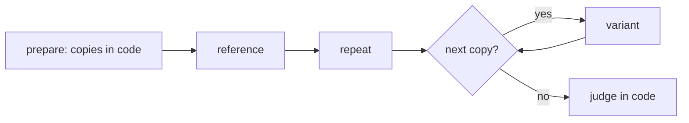

Each run uses the Screening agent's own `match_requirements`, `mandatory_gate` and `score_candidate`. The two unchanged runs give the chance band; a copy is flagged only when it moves more than that plus one 5-point step, or the must-have check changes. A result that is not steady waits for a person to acknowledge it. Details: [innovation-design.md](innovation-design.md).

## Access separation (N9)

The hiring team logs in with a token. A candidate holds only an invite token, which can reach only the join page, the video token and the audio socket for that one interview. Every endpoint that returns scores, rankings, assessments or chat requires the hiring-team login, and tests check that an invite token is refused there.

## Observability (N22)

The API writes one JSON line per event, limited to a fixed list of safe fields (ids, counts, times and error types). See `docs/privacy.md`.