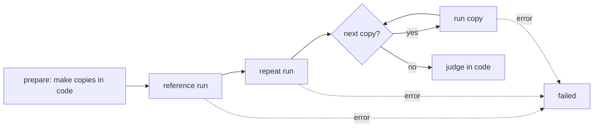

# Litmus (F11): Design

The rationale is in [innovation-rationale.md](innovation-rationale.md). This note says how it works.

## User flow

1. A candidate is screened as usual (Module 5 and 6).
2. On the candidate page, the **Litmus** tab has one button: **Run Litmus**. The check runs in the
   background; the tab shows each step while it works.
3. The result is one of three outcomes:
   - **Steady**: no copy moved more than the noise band allows.
   - **Needs review**: at least one copy moved too much. The reasons are listed per copy.
   - **Inconclusive**: the unchanged profile itself moved too much between two runs, so the test cannot
     tell a real effect from chance.
4. "Needs review" and "Inconclusive" stay open until an interviewer writes a note and presses
   **Acknowledge**. The note, the person and the time are stored. The score is never changed.
5. On the job's candidate page, the **Litmus** card shows the job's pass rate, which kind of change moved
   scores most often, and a button to check the top of the shortlist in one go.

## How one check works

- **One run** = the real screening steps after the CV was read: `match_requirements`, `mandatory_gate`
  and `score_candidate` from the Screening Agent, then `scoring.aggregate()` with the job's weights.
  Nothing is copied or rewritten, so Litmus tests the scorer that is really used.
- **The copies** are made by plain code from the stored profile:

| Copy | What changes | What stays |
|---|---|---|
| Contact details removed | name, e-mail, phone (and the name wherever it appears in the text) | everything else |
| Different name A / B | the name (everywhere) and a matching example e-mail | everything else |
| University names removed | every `institution` in education | degree, field, year |

  The two names are fixed, documented, made-up names that differ in the gender and region they usually
  suggest. Litmus never guesses anything about the real candidate. A copy that would be identical to the
  original (for example no university in the CV) is skipped and shown as "not applicable".

- **The noise band** is the difference between the reference run and the repeat run, per dimension.
- **A copy is flagged** when:
  - a dimension moves by more than its noise plus 5 points (one scoring step), or
  - the must-have check excludes or includes the candidate differently, or
  - a must-have requirement's verdict changes and it did not change between the two unchanged runs.
- **Inconclusive** when the two unchanged runs differ by more than 10 points on any dimension, or give a
  different must-have result.

## Data model

One new table, `litmus_checks`. Every check is its own row; running again adds a row, so the history
is never rewritten.

| Column | Meaning |
|---|---|
| candidate_id | the candidate (deleted with them, N19) |
| status, step, error | queued / running / done / failed, for the screen |
| result | the runs, the noise band, the comparison per copy and the outcome |
| input_hash | a fingerprint of the profile, the job and the weights at the time of the check |
| review_status, review_note, reviewed_by, reviewed_at | the human acknowledgement |
| llm_calls, input_tokens, output_tokens, cost_usd | what the check used and cost |
| started_at, finished_at, seconds | timing |

The changed copies themselves are never stored, only their scores. A check is shown as **outdated** when
the input hash no longer matches (the candidate was screened again, or the job or its weights changed).

## Integration points

- `app/agents/litmus_agent.py`: the LangGraph agent (prepare, reference, repeat, copy loop, judge).
- `app/litmus.py`: the copies and the comparison, plain code only.
- `app/litmus_run.py`: background runs, the queue for a shortlist, the review step and the job summary.
- `app/llm.py`: `measure_usage()` counts tokens for every AI call made inside it.
- `app/routers/litmus.py`: the API, interviewers only.
- `app/privacy.py`: counts the new rows, so a candidate delete shows and removes them.
- Screens: the Litmus tab on the candidate page, and the Litmus card on the job's candidate page.

## Privacy (N9, N16, N19, N20)

- Interviewers only; the candidate never sees it.
- No personal attribute is inferred or stored. The copies only exist in memory during the check.
- The rows go with the candidate when the candidate is deleted.

## Cost

A full check makes about 12 AI calls (2 per run, 6 runs). The exact calls, tokens and cost are stored with
every check and shown on the screen. The prices per million tokens are settings
(`LLM_PRICE_INPUT_PER_MILLION`, `LLM_PRICE_OUTPUT_PER_MILLION`), so they can be updated when Groq changes them.

## Known limits

- It tests what the profile shows. Proxies that stay in the text (writing style, club names, languages) are
  not changed, because some of them are real job requirements (for example JLPT N3).
- One repeat run gives a rough noise band, not an exact one. That is why a wide band is reported as
  inconclusive rather than passed.
- It tests the scoring steps, not the CV reading step before them.
- A steady result means "no effect found for these changes", not "proven fair".
